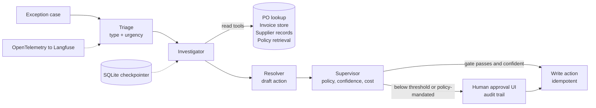

# Invoice and Order Exception Resolution Agent

A multi-agent system that triages, investigates, proposes a resolution and escalates when
unsure, for finance and operations exceptions. **All data is synthetic.** Built as a portfolio
project with evaluation, observability, cost control and security as first-class parts.

Status: **Phase 0 complete (awaiting approval). No agent code and no results yet.**
See [PHASES.md](PHASES.md).

## Problem

Accounts-payable teams spend time on invoice exceptions: price mismatch, missing purchase
order, duplicate invoice, wrong supplier details, quantity mismatch, partial delivery. Each has
a policy answer, but evidence is messy and some cases are genuinely ambiguous. The system must
resolve the clear ones safely and hand the rest to a person, and it must prove how well it does
that.

## Architecture (planned)

## Run

Not available yet. The one-command run is added in a later phase. Today you can run the
checks: see [SETUP.md](SETUP.md).

## Results

No results yet. Results tables with confidence intervals will appear in
[RESULTS.md](RESULTS.md) and be copied here, using only numbers produced by runs.

## Limitations (known at Phase 0)

- Synthetic data only; real invoices are messier in ways the generator will not capture.
- Free-tier quotas limit how often full evaluations can run (see [docs/QUOTAS.md](docs/QUOTAS.md)).
- Generator labels and the runtime gate share one policy engine (ADR-001); hand labels audit this.

## Cost and latency

Pending. Cost will be reported as notional cost at list price (ADR-010).

## Documents

[DECISIONS.md](DECISIONS.md) · [RESULTS.md](RESULTS.md) · [LEARNINGS.md](LEARNINGS.md) ·
[CLAIMS.md](CLAIMS.md) · [docs/TAXONOMY.md](docs/TAXONOMY.md) · [docs/POLICY.md](docs/POLICY.md) ·
[docs/PROJECT_RULES.md](docs/PROJECT_RULES.md)

Licence: MIT.
